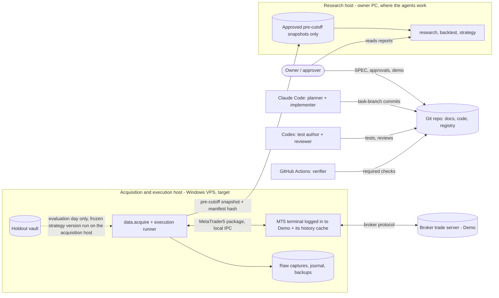
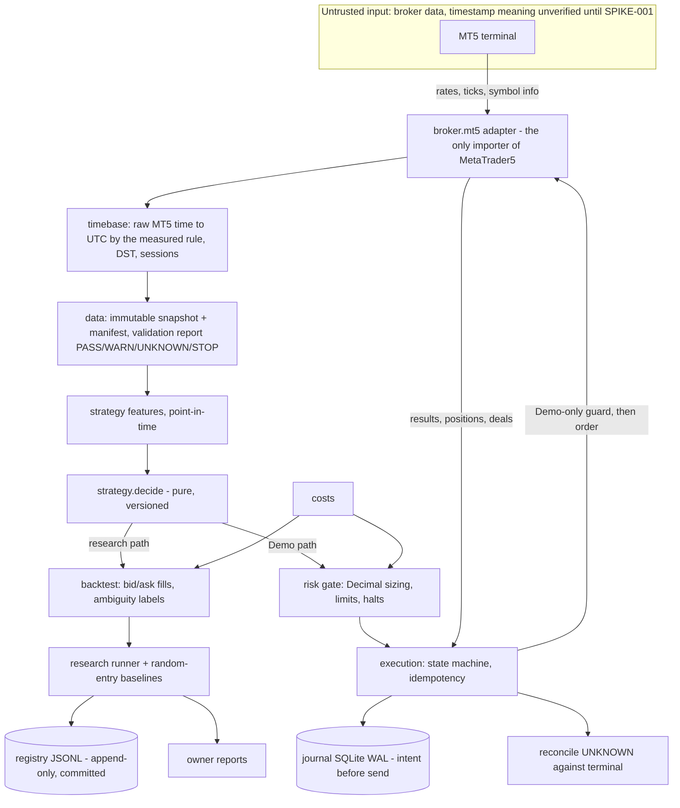

# สถาปัตยกรรมเริ่มต้นของ Sochron1k

สถานะ: **Accepted (D-001)** — เจ้าของอนุมัติ 2026-10-21 ราว 06:55 +07 (ขอบเขตการอนุมัติอยู่ใน DECISIONS.md D-001) · ร่างเมื่อ 18 ต.ค. 2026 โดย Claude Code ตาม Handbook v5 บท 6 และบท 34 (P04)
ปรับปรุง 2026-10-21 ตาม `docs/reviews/D-001-design-r1.md` (Codex adversarial design review หลัง SPIKE-001): F1 แยกเครื่อง (ข้อ 6.1), F2 execution scope (ข้อ 7.1), ข้อเท็จจริงจาก SPIKE-001 (ข้อ 2, 12) และ phase gates (ข้อ 13a) · ผ่าน review r2–r3 แล้ว และเจ้าของรับ D-001 เมื่อ 2026-10-21 · โมดูลแรกตามแผนข้อ 10 (`timebase`, CORE-001) merge แล้ว 2026-10-21 (PR #8)

## 1. สรุปข้อเสนอ

- ทำเป็น **Python modular monolith ตัวเดียว** รันบน Windows และคุยกับ MT5 terminal ผ่านแพ็กเกจทางการ `MetaTrader5` โดยตรง ไม่ต้องมี EA bridge, web server, database server หรือ Docker ในรอบแรก
- **วิจัยก่อน เทรดทีหลัง**: slice แรกที่ใช้งานจริงคือวงวิจัยบนข้อมูลจริง (snapshot → ตรวจข้อมูล → สมมติฐาน → backtest → registry → รายงาน) ส่วนการส่งคำสั่งบน Demo เป็น slice ถัดไป
- กลยุทธ์เป็น **pure function ชุดเดียว** ใช้ทั้ง backtest และ Demo, เวลาแปลงผ่าน **โมดูลเดียว** และ **risk gate** อยู่หน้าทุกคำสั่ง
- เริ่มจาก spike แบบอ่านอย่างเดียว (SPIKE-001) เพื่อพิสูจน์ว่าเชื่อม MT5 ได้จริง และรู้ความหมายของเวลาในข้อมูลของโบรกเกอร์ ก่อนลงทุนเขียนระบบ ผลของ spike ใช้ตัดสินรับหรือปฏิเสธ D-001

## 2. ข้อเท็จจริงที่ใช้ตัดสิน (ตรวจเมื่อ 18 ต.ค. 2026)

| ข้อเท็จจริง | ที่มา |
|---|---|
| เครื่องพัฒนาเป็น Windows 11 มี Git Bash, Node.js v26.12.0 และ uv 0.13.0 (มี CPython 3.12.15 และ 3.15.0 ผ่าน uv) แต่ไม่มี system Python และไม่มี Docker | ตรวจคำสั่งบนเครื่อง |
| ยังไม่พบ MT5 terminal ในตำแหน่งมาตรฐาน (Program Files, %APPDATA%\MetaQuotes) | ตรวจบนเครื่อง |
| `MetaTrader5` 5.0.6231 (ออก 27 ก.ย. 2026) มี wheel เฉพาะ `win_amd64` สำหรับ cp310–cp314 จึงใช้ได้เฉพาะ Windows และยังไม่รองรับ Python 3.15 | pypi.org/pypi/MetaTrader5 |
| เอกสาร Python API ของ MetaQuotes ระบุว่า MT5 เก็บเวลา tick และเวลาเปิดแท่งเป็น UTC "without the shift" และ "Data received from the MetaTrader 5 terminal has UTC time" | mql5.com/en/docs/python_metatrader5 (copy_rates_from, copy_ticks_from) |
| ฟอรัม MQL5 (moderator, ในกระทู้เรื่อง CopyRates ของ MQL5) ระบุว่าข้อมูลที่ MT5 ส่งเป็นเวลา server ของโบรกเกอร์ และไม่มีฟังก์ชันทางการที่บอก offset หลักฐานสองแหล่งนี้ขัดกัน จึงยังสรุปไม่ได้ ต้องวัดจริงใน SPIKE-001 (Handbook บท 34: เอกสารกับพฤติกรรมจริงอาจไม่ตรงกัน) | mql5.com/en/forum/517974 (Handbook S22) |
| Claude Code 2.1.301 อ่าน AGENTS.md ผ่าน `@AGENTS.md` ใน CLAUDE.md ส่วน Codex IDE 26.1007 อ่าน AGENTS.md เองและหา skills จาก `.agents/skills/` | เอกสารทางการของทั้งสองเครื่องมือ |
| รอบก่อน (git `a3b3fbf`) มี 415 ไฟล์, 37 contracts, 40 ADRs ใช้ React/Vite + FastAPI + worker + MQL5 EA bridge + Supabase + Docker แต่ README ระบุว่ายังไม่เคยมี Demo round trip จริง และไม่มีข้อมูลจริงสำหรับ replay/backtest | README และ docs ที่ `a3b3fbf` |

ข้อเท็จจริงเพิ่มจาก SPIKE-001 (รัน 2026-10-21 02:53–03:17 +07, merge ใน PR #3 `3817f36`, review r1–r4, `docs/evidence/SPIKE-001.md`):

| ข้อเท็จจริง | ขอบเขตของหลักฐาน |
|---|---|
| Python 3.12 + `MetaTrader5` 5.0.6231 + `numpy` 2.5.4 เชื่อม terminal build 6274 ของ Exness (`Exness-MT5Trial14`, Demo ลงท้าย 8107, Read Only) ได้ | เครื่องนี้ บัญชีนี้ อ่านอย่างเดียว ยังไม่พิสูจน์การส่งคำสั่ง |
| เวลา tick และแท่งที่ API คืนมาตรงกับนาฬิกาเครื่องที่ offset 0 (12 ครั้ง) และไม่เปลี่ยนในช่วง DST ของ US และ EU เดือนมีนาคม 2026 (M1) | server เป็น GMT+0 จึงยังแยก "UTC ตามเอกสาร" กับ "เวลา server" ไม่ได้ (AC-04 UNKNOWN) · นาฬิกา Windows ยังไม่ sync · ใช้ได้กับ server นี้เท่านั้น |
| M1 แท่งแรกที่ได้คือ 2014-01-14 แต่ปี 2014–2016 มีราว 1 แท่งต่อวัน และปี 2017 ผิดปกติ · tick แรกที่ได้คือ 2026-01-01 23:05 | **ปีที่เริ่มใช้วิจัยได้ = UNKNOWN** ต้องตรวจคุณภาพรายวันหรือรายเดือนก่อนเลือกช่วงข้อมูล · ไม่บอก bid/ask ย้อนหลังหรือต้นทุนในอดีต |
| เวลาทำการของ `XAUUSDm` ณ 2026-10-21 จากหน้าต่าง Specification ที่เจ้าของส่งมา | ภาพไม่บอกเขตเวลา และเป็นตารางช่วง EDT ไม่ใช่ตารางทั้งปี |

ข้อสังเกตจากรอบก่อน: งานส่วนใหญ่ไปอยู่ที่ระบบรอบตัว (bridge, sync, dashboard, alert) ก่อนที่จะมีหลักฐานแม้แต่ชิ้นเดียวว่ากลยุทธ์มีความได้เปรียบ ซึ่งตรงกับกับดักในบท 34 ("ผลลัพธ์ของงานประเภทนี้คือหลักฐานว่ามีความได้เปรียบ ไม่ใช่ฟีเจอร์") และรูปแบบ F15 (ออกแบบเกินจำเป็น) ข้อเสนอรอบนี้จึงกลับลำดับ: พิสูจน์ข้อมูลและความได้เปรียบก่อน

## 3. หลักที่ใช้ตัดสิน

1. ผลลัพธ์คือหลักฐานว่ามี edge หลังหักต้นทุน ไม่ใช่จำนวนฟีเจอร์ (บท 34)
2. โครงสร้างเล็กที่สุดที่รองรับข้อจำกัดจริง แยก module ก่อนแยก service ใช้เทคโนโลยีที่น่าเบื่อและ AI รู้จักดี (บท 6)
3. Strategy เป็น pure function ชุดเดียวทั้ง backtest และ live (บท 34)
4. MT5 เป็นความจริงของราคา คำสั่ง และ position ถ้าผลไม่แน่ชัดให้เป็น UNKNOWN แล้ว reconcile (บท 20, 34)
5. Risk gate ของเราอยู่หน้าทุกคำสั่ง และ Demo-only ต้องบังคับด้วยโค้ด ไม่ใช่ config (บท 13, 34)
6. ทดสอบได้ใน CI บน Linux โดยไม่ต้องมี MT5 ส่วนที่ต้องใช้ MT5 แยกไว้หลัง adapter ตัวเดียว
7. เจ้าของคนเดียวต้องดูแลไหว ไม่เพิ่มภาระ ops เกินจำเป็น

## 4. ทางเลือก

| ประเด็น | A. Python monolith + `MetaTrader5` (แนะนำ) | B. MQL5 EA ส่งคำสั่ง + Python วิจัย/สั่งงานผ่าน bridge | C. MQL5 ล้วน (EA + Strategy Tester) |
|---|---|---|---|
| ภาพรวม | แอป Python เดียว คุย terminal ผ่าน IPC ของแพ็กเกจทางการ | EA ใน terminal ทำหน้าที่ executor, Python ส่ง command ผ่านไฟล์/HTTP | ทุกอย่างอยู่ใน EA, วิจัยด้วย Strategy Tester |
| Strategy ชุดเดียว backtest = live | ได้ ตรงๆ | เสี่ยงมีสองชุด (Python วิจัย / MQL5 live) เว้นแต่ EA เป็นแค่ executor | ได้ (MQL5 ชุดเดียว) |
| ความเข้มงวดของการวิจัย (registry, holdout, random-entry, golden tests) | ทำได้ครบด้วย Python + pytest | ทำได้ในฝั่ง Python | ยาก, optimizer ของ Tester ชวนให้ลองหลายร้อย variant |
| ทดสอบใน CI | ได้ทุกส่วน ยกเว้น adapter ที่ต้องมี terminal | ฝั่ง EA ทดสอบอัตโนมัติยาก | แทบไม่ได้ |
| ความซับซ้อน | ต่ำ ภาษาเดียว process เดียว | สูง สองภาษา + protocol bridge + journal สองฝั่ง | กลาง แต่ test/วิเคราะห์ยาก |
| ข้อจำกัดของ host | ต้องรันบน Windows (terminal + Python เครื่องเดียวกัน) | Python อยู่ที่ไหนก็ได้ แต่ EA ต้องอยู่กับ terminal | Windows (terminal) |
| ความแม่นของ AI agent | สูง (Python กระแสหลัก) | กลาง (MQL5 ตัวอย่างน้อยกว่า) | กลาง–ต่ำ |
| ทำงานต่อเมื่อ Python ล่ม | ไม่ได้ แต่ SL/TP อยู่ฝั่ง server ของโบรกเกอร์อยู่แล้ว | EA ทำงานต่อได้ | ทำงานต่อได้ |
| ค่าใช้จ่าย [A] (ขอบเขตอยู่ใต้ตาราง) | 0 บนเครื่องเจ้าของ [A] | 0 + เวลาพัฒนา bridge [A] | 0 [A] |
| สิ่งที่ย้อนกลับยาก | น้อย ถ้าแยก adapter ไว้ เปลี่ยนเป็น B ภายหลังได้ | protocol และ journal สองฝั่ง | การวิจัยผูกกับ MQL5 |

ขอบเขตของแถว "ค่าใช้จ่าย" [A]: นับเฉพาะค่า license และค่าบริการที่ต้องจ่ายเพิ่มเพราะเลือกทางนั้น โดยสมมติว่ารันบนเครื่องเจ้าของ · ไม่รวม VPS, ค่าข้อมูลจากแหล่งอื่น, ค่าไฟ, ค่าคอมมิชชันหรือ spread ของโบรกเกอร์ และเวลาพัฒนา (ยกเว้นที่เขียนไว้ในช่อง) · ยังไม่ได้ประเมินตัวเลขจริง งบรายเดือนยังเป็น TBD ตาม SPEC ข้อ 6 และ Q-10

**ทำไมรอบก่อนเลือก B แต่รอบนี้ไม่จำเป็น** รอบก่อนพัฒนาบน macOS (มีร่องรอย Colima และ `.venv/bin/python`) ซึ่งใช้แพ็กเกจ `MetaTrader5` ไม่ได้ จึงต้องมี EA + bridge ตอนนี้เครื่องเป็น Windows เงื่อนไขนั้นหมดไปแล้ว

## 5. ข้อเสนอ: ทางเลือก A

เลือก A เพราะรักษาหลัก "strategy ชุดเดียว" ได้ตรงที่สุด ทดสอบได้มากที่สุด และมีชิ้นส่วนน้อยที่สุดสำหรับเจ้าของคนเดียว

Stack ที่เสนอ (ยังไม่ติดตั้ง ต้องผ่าน dependency admission ทีละตัวเมื่อ contract ต้องใช้):
- Python **3.12.x** ผ่าน uv (มีในเครื่องแล้ว, มี wheel ของ `MetaTrader5`, ไลบรารีวิทยาศาสตร์รองรับครบ, หมดอายุ ต.ค. 2028) ส่วน 3.13/3.14 ก็ใช้ได้ แต่ 3.15 ใช้ไม่ได้
- `MetaTrader5` (MetaQuotes) เฉพาะใน `broker/mt5` และ optional บน Windows เท่านั้น เพื่อให้ CI บน Linux ติดตั้งส่วนอื่นได้
- pytest (+ hypothesis สำหรับ property tests ของ risk sizing), ruff, pyright
- ข้อมูล: numpy, pandas, pyarrow (Parquet) · journal และ registry: sqlite3 / JSONL จาก stdlib
- `tzdata` (Windows ไม่มีฐานข้อมูล timezone ให้ `zoneinfo`)
- CLI ด้วย `argparse` จาก stdlib (ไม่เพิ่ม framework)

ถ้าจะเปลี่ยนจาก A ไป B ภายหลัง ให้กลับมาทบทวนเมื่อเกิดเงื่อนไขใดเงื่อนไขหนึ่ง: ต้องย้ายไป host ที่ไม่ใช่ Windows, ต้องการ logic ฝั่ง terminal ที่ทำงานต่อได้แม้ Python ล่ม (เช่น trailing stop ที่ซับซ้อน), หรือ latency ต้องต่ำกว่าที่ Python polling ทำได้

## 6. ภาพรวมระบบ (system context)



### 6.1 ขอบเขตของเครื่อง (ตอบ review D-001 r1 F1)

เป้าหมาย (เจ้าของตัดสิน 2026-10-21 ว่าจะขึ้น MT5 บน Windows VPS):

| อยู่บน acquisition/execution host (Windows VPS) | อยู่บน research host (เครื่องเจ้าของ ที่ Claude และ Codex ทำงาน) |
|---|---|
| MT5 terminal และ history cache ของมัน · `data.acquire` · raw captures · journal และ backup · holdout vault · Demo runner (E1/OPS-1) · การประเมิน holdout ด้วย strategy version ที่ freeze แล้ว | `research`, `backtest`, `strategy`, `costs`, `data.snapshot` · snapshot ก่อน cutoff ที่อนุมัติแล้ว พร้อม manifest hash · **ไม่มี** MT5 terminal, terminal cache, ความสามารถดึงข้อมูลจากโบรกเกอร์ หรือ holdout |

- โฟลเดอร์คนละที่, VM บนเครื่องเดียวกัน หรือการแยกสิทธิ์ผู้ใช้ **ไม่ถือว่า** อยู่นอกเครื่องวิจัย ถ้าจะใช้แทนต้องเป็นการตัดสินเปลี่ยนกฎของเจ้าของที่บันทึกใน DECISIONS
- ค่าใช้จ่ายของ VPS นับใน Q-10 (ยัง TBD) ไม่ถือว่าเป็น 0 อีกต่อไป

**ระยะนี้ (เจ้าของตัดสิน 2026-10-21: "ตอนนี้เอาบนเครื่องนี้ก่อน"):**
- ทั้งสองบทบาทอยู่บนเครื่องเจ้าของ เครื่องนี้จึง**ยังไม่ใช่** research host ที่แยกตามข้อกำหนด
- ระหว่างนี้ **ห้ามตัด holdout, ห้าม ingest ข้อมูลเพื่อวิจัย และห้ามทดลองกลยุทธ์ใน SLICE-R1**
- งานที่ทำได้: ตัดสินและเตรียมสถาปัตยกรรม, เขียนโค้ดที่ไม่ใช้ข้อมูลตลาดจริง (เช่น timebase, costs, risk แบบ pure พร้อม tests) ภายใต้ contract ที่อนุมัติ และงานเตรียม VPS
- ถ้าเจ้าของต้องการเริ่มวิจัยก่อนมี VPS ต้องตัดสินเปลี่ยนกฎแยกต่างหาก

**ด่านก่อน SLICE-R1 (ENV-1):**
- VPS พร้อมใช้งาน และย้าย terminal, raw captures และ holdout ไปแล้ว
- ลบ terminal และ history cache ออกจาก research host
- environment check พร้อม **synthetic excluded-period sentinel** (ข้อมูลปลอมช่วงที่ตัดออก ไม่ใช้ holdout จริง) พิสูจน์ว่า research identity อ่านหรือดึงช่วงนั้นไม่ได้ ทั้งโดยตรงและผ่าน `data`

## 7. Data flow และ trust boundaries



Trust boundaries ที่ต้องบังคับจริง:
- ข้อมูลจากโบรกเกอร์เป็น input ที่ไม่น่าเชื่อถือ ตรวจที่ boundary (bid > ask, เวลาถอยหลัง, ช่องว่าง) แล้วรายงาน ห้ามซ่อมเงียบ
- ระหว่าง strategy กับ execution: strategy ส่งได้แค่ "การตัดสินใจ" ส่วนสิทธิ์ส่งคำสั่งอยู่ที่ risk gate + execution เท่านั้น
- ระหว่างแอปกับบัญชี: การเช็กว่าเป็น Demo อย่างเดียวไม่พอ ทุก action ภายนอกต้องอยู่ใน **execution scope** ที่อนุมัติ (ข้อ 7.1) ถ้าไม่ตรงหรือไม่รู้ ให้ปฏิเสธและหยุด
- ระหว่าง research กับ holdout: research host ไม่มี holdout, terminal, terminal cache หรือ `data.acquire` (ข้อ 6.1) รับเฉพาะ snapshot ก่อน cutoff ที่ตรวจ manifest hash แล้ว · การประเมิน holdout รันบน acquisition host ด้วย strategy version ที่ freeze แล้ว · ระยะนี้ที่ยังใช้เครื่องเดียว ขอบเขตนี้**ยังไม่มีผล** จึงห้ามงานที่ต้องพึ่ง holdout
- ระหว่าง agent กับ repo: locked paths บังคับด้วย deny rules + hooks + CI (D-004)

### 7.1 Execution scope (ตอบ review D-001 r1 F2)

**Scope แก้ไม่ได้ระหว่างรัน** กำหนดใน contract ที่อนุมัติ (ไม่มี credential) และ execution ได้รับเป็นค่าคงที่ตอนเริ่ม:

| องค์ประกอบ | ตัวอย่างจาก SPIKE-001 |
|---|---|
| terminal identity | company และ build ที่คาดไว้ |
| server | `Exness-MT5Trial14` |
| บัญชีที่อนุญาต | เลขเต็มอยู่ใน config บนเครื่อง ส่วนในเอกสารและ log แสดงแบบปิดบัง |
| trade mode | Demo |
| action ที่อนุญาต | E1: เปิดพร้อม SL, แก้ SL ให้แคบลงเท่านั้น, ปิด |
| สัญลักษณ์ที่อนุญาต | `XAUUSDm` |
| volume สูงสุด | ตาม risk gate |
| วันหมดอายุ | กำหนดใน contract |

**ตรวจเมื่อไหร่:**
- ตอนเริ่ม
- ทุกครั้งที่ reconnect หรือ initialize ใหม่
- **ก่อนทุก action ภายนอก** ทุกครั้ง

ถ้า identity ใดไม่ตรง ไม่รู้ หรือเลยวันหมดอายุ ให้หยุดทุก action ภายนอก บันทึก halt ลง journal แล้วรอเจ้าของ

**ผูก state กับ scope:**
- journal, risk snapshot และการ reconcile อ้างถึง scope id
- หลัง restart ห้าม reconcile หรือส่งต่อกับบัญชีที่ไม่ตรง scope ของ intent ที่ค้างอยู่

**ผู้ส่งคำสั่งต่อ scope มีหนึ่งตัวเท่านั้น:** ใช้ terminal เฉพาะงานนี้ และห้ามสลับบัญชีด้วยมือระหว่างที่ runner ทำงาน

**ความเสี่ยงที่ยังเหลือ (ระบุตรงๆ):**
- การเช็ก scope กับการส่งคำสั่งเป็นคนละ call กันใน Python API และ `order_send` ไม่มีช่องระบุบัญชี
- การเช็กก่อนส่งจึงลดความเสี่ยงได้ แต่**กันไม่ได้ 100%** ถ้ามีคนสลับบัญชีในจังหวะระหว่างสอง call
- การจัดการ: ใช้ terminal เฉพาะงาน, เช็กซ้ำหลังส่ง และ reconcile กับบัญชีของ scope

**สิทธิ์อ่านอย่างเดียวของ SPIKE-001** แยกจากสิทธิ์ของ E1 และไม่ได้ทำให้ส่งคำสั่งได้

## 8. Module map และกฎ import

โฟลเดอร์จะถูกสร้างเมื่อ contract ต้องใช้จริงเท่านั้น โฟลเดอร์ว่างไม่ใช่หลักฐานว่ามีส่วนนั้นอยู่

| Module (`src/sochron/…`) | หน้าที่ | ห้าม | import ได้เฉพาะ |
|---|---|---|---|
| `core` | ชนิดข้อมูลกลาง: Instrument, Bar, Tick, Side, Money (Decimal) | I/O | – |
| `timebase` | แปลงเวลาดิบจาก MT5 ↔ UTC ตามกติกาที่ SPIKE-001 วัดได้, DST, sessions, วันเทรดแบบไทย | เรียกนาฬิกาเอง (รับ `now` เป็น argument) หรือสมมติ offset เอง | core |
| `data.snapshot` | อ่าน snapshot + manifest ที่อนุมัติแล้วแบบ offline, ตรวจ hash, validation report | แก้ข้อมูลดิบเงียบๆ, เรียก broker | core, timebase |
| `data.acquire` | ดึงข้อมูลผ่าน broker port, สร้าง snapshot + manifest (รันบน acquisition host เท่านั้น) | ถูก import โดย research, backtest หรือ strategy | core, timebase, broker (port), data.snapshot |
| `strategy` | features + `decide()` แบบ pure และมี version | I/O, clock, MetaTrader5, random ที่ไม่มี seed | core, timebase |
| `costs` | spread, commission, slippage, swap และ stress ×2 | – | core |
| `backtest` | จำลองการเทรดด้วย bid/ask, ติดป้าย ambiguous เมื่อ SL/TP อยู่ในแท่งเดียวกัน | อ่าน holdout | core, timebase, strategy, costs |
| `research` | runner, registry, random-entry baseline, holdout gate, สถิติ, รายงาน | เรียก broker, execution หรือ `data.acquire` | core, timebase, data.snapshot, strategy, costs, backtest |
| `risk` | sizing ด้วย Decimal, limits, halt state | ถูกเปลี่ยนโดย AI หรือ config ระหว่างรัน | core, costs |
| `execution` | วงจรชีวิตคำสั่ง, idempotency, reconcile | ส่งคำสั่งโดยไม่ผ่าน risk gate และ journal | core, risk, journal, broker (port) |
| `broker` | port + `mt5` adapter (ตัวเดียวที่ import MetaTrader5) | ตัดสินใจเชิงกลยุทธ์ | core, timebase |
| `journal` | SQLite WAL: intent, events, external IDs, halts | ลบประวัติ | core |
| `app` | CLI, ตรวจ config ตอนเริ่ม (fail fast), ประกอบชิ้นส่วน | business logic | ทุกโมดูล |

```text
src/sochron/<modules>        # implementation (Claude Code)
tests/unit, tests/integration # implementer tests
tests/acceptance/<task>/      # test author, locked
tests/golden/<task>/          # test author, hand-computed answers, locked
tests/architecture/           # import-rule checks, locked
research/registry/*.jsonl     # append-only, committed
spikes/<SPIKE-ID>/            # disposable spike code, never imported by src
data/ journal/ reports/out/   # runtime data, gitignored
```

## 9. Invariants ระดับระบบ และจุดที่บังคับ

| Invariant | บังคับด้วย |
|---|---|
| ไม่มีเส้นทางไปบัญชีเงินจริง | Demo guard ในโค้ด + negative test + red-flag "Order or account mutation surface" |
| ทุก action ภายนอกอยู่ใน execution scope ที่อนุมัติ (ข้อ 7.1) | ตรวจ identity, บัญชี, server, สัญลักษณ์, action และวันหมดอายุตอนเริ่ม ตอน reconnect และก่อนทุก action · journal และการ reconcile ผูกกับ scope · E1 negative tests (ข้อ 13) |
| ไม่มีคำสั่งไหนถูกส่งโดยไม่ผ่าน risk gate และ journal | โครงสร้าง module (execution เท่านั้นที่เรียก broker send) + architecture test |
| ส่งแล้วผลไม่ชัด = UNKNOWN และ reconcile ก่อน retry | state machine + test กรณี timeout |
| Strategy ไม่มี I/O และไม่ import MetaTrader5 | architecture test (AST) ใน `tests/architecture/` |
| เวลาแปลงผ่าน timebase เท่านั้น | architecture test + leakage audit |
| สมมติฐานแก้ไม่ได้หลัง commit / registry เพิ่มได้อย่างเดียว | hook + `control-gate` (ตรวจทุก commit ด้วยตัวตรวจจาก base revision) |
| Holdout ไม่อยู่ในเครื่องวิจัย และเครื่องวิจัยดึงช่วงนั้นไม่ได้ | แยกเครื่องตามข้อ 6.1 · ด่าน ENV-1 ก่อน R1: environment check + synthetic excluded-period sentinel · architecture test: `research`/`backtest`/`strategy` ห้าม import `data.acquire` หรือ `broker` · loader ปฏิเสธช่วงหลัง cutoff เป็นชั้นเสริม ไม่ใช่ขอบเขตหลัก · ระยะนี้ที่ยังใช้เครื่องเดียว: ห้ามตัด holdout และห้ามทดลองกลยุทธ์ |
| ไม่มี secret ใน repo/log | `.gitignore`, deny rules, red-flag scan |

## 10. ลำดับการสร้าง (vertical slices)

| Phase | Contract | ได้อะไร | เกณฑ์จบ | Tier |
|---|---|---|---|---|
| 0 | BOOT-001 | กติกา, controls, skills/agents, architecture ร่าง | เจ้าของรับ D-002 ถึง D-005 และ P25 ผ่านทั้งสองเครื่องมือ (สถานะ 2026-10-21: merge แล้ว PR #1–#2; D-001 accepted; D-002, D-004, D-005 ยัง proposed; P25 ของ Codex ใน IDE ยัง UNKNOWN ตาม D-008) | High (Q6) |
| 1 | SPIKE-001 | พิสูจน์ว่าเชื่อม MT5 ได้, รู้ว่า timestamp เป็น UTC หรือเวลา server และพฤติกรรมช่วง DST, รู้ความลึกของข้อมูล (อ่านอย่างเดียว, environment uv ชั่วคราว, ไม่ต้องรอ D-001) | evidence report และไม่มีการส่งคำสั่งใดๆ | Standard |
| 1b | ตัดสิน D-001 | Codex `$adversarial-design-review` พร้อมหลักฐานจาก SPIKE-001 แล้วเจ้าของรับหรือปฏิเสธ D-001 | ADR เปลี่ยนเป็น accepted หรือ rejected | – |
| 1c | ENV-1 | Windows VPS เป็น acquisition/execution host, ย้าย terminal/raw/holdout, ลบ terminal และ cache ออกจาก research host, environment check + synthetic sentinel (ข้อ 6.1) | sentinel พิสูจน์ว่า research identity อ่านหรือดึงช่วงที่ตัดออกไม่ได้ | Standard (มีค่าใช้จ่าย, Q-10) |
| 2 | SLICE-R1 (เริ่มได้หลัง ENV-1 ผ่าน) | วงวิจัยครบ: snapshot → validation → H001 → golden tests → backtest + costs → registry → รายงานเทียบ random-entry | เจ้าของตัดสิน go/stop/insufficient จาก 3 รายงาน (ข้อมูล, golden, registry) | Standard |
| 3 | SLICE-E1 | วง Demo ครบ: risk gate → คำสั่งพร้อม SL → MT5 ยืนยัน → journal → ปิด → reconcile → restart recovery | round trip ที่ MT5 ยืนยัน พร้อม negative cases | Standard + external-action controls |
| 4 | OPS-1 | รัน Demo แบบไม่ต้องเฝ้า: scheduler, alert, backup/restore | ซ้อม restore และ alert จริงผ่าน | Standard/High |
| – | เงินจริง | อยู่นอกขอบเขต | ต้องมี SPEC รุ่นใหม่, threat model, ADR และ controls ระดับ High | High |

SLICE-E1 เริ่มได้เมื่อ (ก) มี strategy version ที่ผ่าน R1 หรือ (ข) เจ้าของอนุมัติ "engineering test" ด้วย volume ขั้นต่ำและระบุชัดว่าไม่ใช่การทดสอบ edge

## 11. สิ่งที่ตั้งใจยังไม่ทำ และ trigger ที่จะกลับมาพิจารณา

| ยังไม่ทำ | กลับมาพิจารณาเมื่อ |
|---|---|
| Web dashboard / ดูผลจากที่อื่น | E1 รันแบบไม่เฝ้า และเจ้าของต้องดูจากนอกเครื่อง |
| Database server ภายนอก (เช่น Supabase) | ต้องแชร์ข้อมูลข้ามเครื่องหรือ dashboard ต้องใช้ |
| VPS | **เจ้าของวางแผนแล้ว (2026-10-21)**: Windows VPS เป็น acquisition/execution host ต้องมีก่อน SLICE-R1 (ENV-1) เพื่อแยก holdout และใช้เป็น Demo runner ต่อไป (U5) · ถ้าเป็น Linux ต้องทบทวน D-001 |
| News/AI classification | ลงทะเบียนเป็นสมมติฐานแยกพร้อม evals (บท 30) |
| ML models | ต้องชนะ baseline แบบง่ายภายใต้การทดสอบที่ยุติธรรม (บท 34) |
| MQL5 EA | ต้องการ logic ฝั่ง terminal ที่ Python ทำแทนไม่ได้ |

## 12. ความเสี่ยงและสิ่งที่ยังไม่รู้

ทุกแถวในตารางนี้มีสถานะ TBD จนกว่าวิธีพิสูจน์ในคอลัมน์ขวาสุดจะได้ผล

| ID | สิ่งที่ยังไม่รู้ | ผลถ้าผิด | วิธีพิสูจน์ |
|---|---|---|---|
| U1 | แพ็กเกจ `MetaTrader5` attach กับ terminal ของโบรกเกอร์ที่เลือกบนเครื่องนี้ได้จริง | ทั้งทางเลือก A ใช้ไม่ได้ | **พิสูจน์แล้ว (SPIKE-001 AC-01, 2026-10-21)** สำหรับเครื่องนี้และบัญชี Exness Demo · host ใหม่ (VPS) ต้องวัดซ้ำใน ENV-1 |
| U2 | timestamp จาก MT5 Python API เป็น UTC (ตามเอกสาร) หรือเวลา server (ตามรายงานในฟอรัม) และพฤติกรรมช่วง DST | สัญญาณผิดเวลา, look-ahead | **บางส่วน (SPIKE-001):** offset 0 และไม่เปลี่ยนตาม DST บน `Exness-MT5Trial14` · กลไกจริงยัง UNKNOWN (AC-04) · กฎของ timebase ต้องระบุ server, symbol, build และช่วงหลักฐานไว้ด้วย และต้องวัดซ้ำเมื่อเปลี่ยน server |
| U3 | ข้อมูลย้อนหลัง XAU/USD (M1/ticks) จากโบรกเกอร์ลึกและครบพอหรือไม่ | วิจัยได้ไม่พอ หรือต้องหาแหล่งอื่น (มีเรื่อง license) | **บางส่วน (SPIKE-001):** ได้ M1 ตั้งแต่ 2014 แต่ปีที่เริ่มใช้วิจัยได้ยัง UNKNOWN และ tick มีตั้งแต่ 2026-01 · ต้องตรวจคุณภาพข้อมูลใน R1 ก่อนเลือกช่วง |
| U4 | spread และต้นทุนจริงใกล้กับ cost model แค่ไหน | backtest สวยเกินจริง | R1 (cost model) และ E1 (วัดจริง) |
| U5 | เครื่องเจ้าของเปิดต่อเนื่องได้ไหม (sleep, update, reboot) | Demo runner หยุดกลางทาง | OPS-1 |
| U6 | พฤติกรรม `order_send`: timeout, retcode, filling mode ของโบรกเกอร์ | ส่งซ้ำหรือสถานะค้าง | E1 (negative cases) |

## 13a. Phase gates ที่ต้องอยู่ใน contract ถัดไป

ที่มา: `docs/reviews/D-001-design-r1.md` หัวข้อ "Required phase gates" รายการนี้เป็นข้อกำหนดของ contract ในอนาคต ไม่ใช่งานที่ต้องทำตอนนี้ และ contract แต่ละตัวต้องยกเงื่อนไขที่เกี่ยวข้องไปเป็น acceptance

| ก่อน | Gate |
|---|---|
| R1 time/data | ระบุเวอร์ชันของกฎเวลาพร้อม server, symbol, build และช่วงหลักฐาน · เก็บเวลาดิบไว้และคง AC-04 เป็น UNKNOWN · แยกการตรวจสุขภาพนาฬิกา, ความสดของราคา และ offset ออกจากกัน · ห้ามปรับ offset อัตโนมัติจากราคาที่ค้าง |
| R1 data selection | เลือกช่วงข้อมูลจากการตรวจคุณภาพรายวันหรือรายเดือน ก่อนเลือกกลยุทธ์ · freeze สมมติฐานเรื่องปฏิทินและที่มาของต้นทุน · สิ่งที่ไม่รู้ให้คง UNKNOWN |
| R1 first experiment | บันทึก run-start (hypothesis, version, parameters, seed, revision, dataset hash) ก่อนคำนวณ แล้วบันทึกผลหรือความล้มเหลวต่อท้าย · ทดสอบกรณีถูกขัดจังหวะและดิสก์เต็ม |
| R1 ทุกครั้ง | ENV-1 ผ่านแล้ว (ข้อ 6.1) |
| E1 first send | intent ต้องบันทึกลงดิสก์สำเร็จก่อนส่ง (ระบุค่าความทนทานของ SQLite ไม่พึ่ง WAL อย่างเดียว) และหยุดเมื่อ storage error · ผ่าน execution scope (ข้อ 7.1) |
| E1 retry/restart | idempotency key ฝั่งเราไม่ใช่การกันซ้ำของโบรกเกอร์ · UNKNOWN คงอยู่ข้าม restart · reconcile orders, deals และ positions ก่อน retry · ทดสอบ crash ก่อนส่ง, crash หลังส่งแต่ก่อนบันทึก, ข้อมูลเห็นช้า และ runner ซ้อน |
| E1 partial fill/SL | บันทึก volume ที่ fill จริง ยืนยัน SL ของ position ที่เกิดขึ้น และห้าม retry เต็มจำนวนหลัง fill บางส่วน |
| E1 runtime / OPS-1 | terminal ล่ม, หลุดการเชื่อมต่อ, sleep/reboot หรือดิสก์เต็ม → หยุด action ใหม่ คงความไม่แน่นอนไว้ แล้ว reconcile ก่อนเปิดใหม่ · OPS-1 ซ้อม alert และ restore journal ที่มี intent ค้าง |
| เปลี่ยน dependency/host | การอนุมัติของ SPIKE ใช้ได้เฉพาะ spike · dependency ของโปรเจกต์ต้องผ่าน admission แยก · pin environment ให้ทำซ้ำได้ · วัด adapter ซ้ำเมื่อเปลี่ยนแพ็กเกจ, terminal หรือ host |

## 13. Architecture fitness checks ที่วางแผนไว้

- `tests/architecture/` (เขียนโดย test author, locked): ตรวจกฎ import ตามตารางในข้อ 8 ด้วย AST (ไม่ต้องเพิ่ม dependency) เช่น ห้าม import `MetaTrader5` นอก `broker/mt5`, `strategy` import ได้เฉพาะ `core` และ `timebase` และ `research`/`backtest`/`strategy` ห้าม import `data.acquire` หรือ `broker` (F1)
- ENV-1 (ก่อน R1): environment check + synthetic excluded-period sentinel บน research host ตามข้อ 6.1
- CI ที่มีอยู่แล้ว: `control-gate` (pull_request_target ใช้ตัวตรวจจาก base revision และไม่รันโค้ดจาก PR) ตรวจ locked paths, สมมติฐาน immutable และ registry append-only ทีละ commit; `ci` รัน self-tests และ red-flag scan
- ตั้งแต่ E1: negative tests ของ execution scope (ข้อ 7.1) โดยแต่ละกรณีต้องไม่มีการเรียกส่งคำสั่งเลย (zero send calls):
  - trade mode ไม่ใช่ Demo
  - บัญชี Demo อื่น
  - server อื่น
  - สัญลักษณ์หรือ action ที่ไม่อนุญาต
  - scope หมดอายุ
  - identity เปลี่ยนหลัง reconnect
  - restart แล้วพบ intent ที่ค้างอยู่ผูกกับบัญชีอื่น
